# Sensorless Field-Oriented Control with a Fault-Tolerant Observer

### PMSM/BLDC Motor Control | C | Python | ESP32 | PlatformIO | Software-in-the-Loop Simulation

A sensorless Field-Oriented Control (FOC) project that combines rotor-state estimation, model-assisted current-sensor fault detection, phase-current reconstruction, and software-in-the-loop (SIL) validation.

The project investigates how a motor controller can respond when phase-current measurements become unreliable because of sensor offsets, stuck readings, transient noise, or simultaneous faults.

The controller is implemented in C, while a Python-based simulation environment provides a motor model, fault injection, data logging, and automated evaluation.

> **Project status:** Software-in-the-loop development and validation. Physical ESP32 and motor validation, real-time execution profiling, and complete verification of all fault scenarios remain separate engineering tasks.
> 
> **Comprehensive Documentation:** For a complete illustrated manual explaining the motor electromagnetism physics, state observers, fault isolation, all 13 test scenarios with physical response waveforms, and the 128-test verification suite, see the [Illustrated Technical Manual & Physical Guide (PDF)](docs/Sensorless_FOC_Motor_Control_Guide.pdf).

---

## Table of Contents

1. [Project Overview](#1-project-overview)
2. [Objectives](#2-objectives)
3. [System Architecture](#3-system-architecture)
4. [Field-Oriented Control](#4-field-oriented-control)
5. [Sensorless Rotor-State Estimation](#5-sensorless-rotor-state-estimation)
6. [Fault Detection and Isolation](#6-fault-detection-and-isolation)
7. [Phase-Current Reconstruction](#7-phase-current-reconstruction)
8. [Fault-Handling Modes](#8-fault-handling-modes)
9. [Software-in-the-Loop Simulation](#9-software-in-the-loop-simulation)
10. [MATLAB & Simulink PMSM Simulation Suite](#10-matlab--simulink-pmsm-simulation-suite)
11. [Fault Scenarios](#11-fault-scenarios)
12. [Repository Structure](#12-repository-structure)
13. [Prerequisites](#13-prerequisites)
14. [Installation and Setup](#14-installation-and-setup)
15. [Building and Running Tests](#15-building-and-running-tests)
16. [Running Individual Scenarios](#16-running-individual-scenarios)
17. [Robustness Testing](#17-robustness-testing)
18. [ESP32 Build Configuration](#18-esp32-build-configuration)
19. [Evaluation Metrics](#19-evaluation-metrics)
20. [Motor and Controller Parameters](#20-motor-and-controller-parameters)
21. [Current Validation Status](#21-current-validation-status)
22. [Known Limitations](#22-known-limitations)
23. [Future Work](#23-future-work)
24. [Technologies Used](#24-technologies-used)
25. [References](#25-references)

---

# 1. Project Overview

Field-Oriented Control is widely used for controlling permanent-magnet synchronous motors because it provides independent regulation of flux-producing and torque-producing current components.

Conventional sensorless FOC estimates rotor position and speed using electrical measurements instead of relying exclusively on an encoder or resolver.

However, sensorless control becomes more difficult when current measurements are corrupted.

A faulty phase-current measurement can affect:

- Clarke and Park transformations.
- Current feedback used by the PI controllers.
- Back-EMF and rotor-position estimation.
- Speed estimation.
- Fault diagnosis.
- Overall closed-loop stability.

This project explores a model-assisted approach to detecting and handling such failures.

The software combines:

1. A C-based FOC control implementation.
2. A Sliding Mode Observer (SMO).
3. A voltage-model flux observer.
4. An observer-management mechanism.
5. A phase-current fault monitor.
6. An independent current predictor.
7. Fault isolation using competing phase-fault hypotheses.
8. Reconstruction of a suspected faulty phase current.
9. A Python PMSM simulation environment.
10. Automated fault-injection scenarios and evaluation metrics.

The controller and simulation are designed to work together so that changes to the C implementation can be evaluated under repeatable operating conditions.

The primary emphasis is on **sensorless estimation, fault diagnosis, and software-level validation**, rather than claiming completed hardware deployment.

---

# 2. Objectives

The principal objectives of the project are:

- Implement the core FOC control logic in C.
- Estimate rotor electrical position and speed without using a rotor-position sensor in the observer feedback path.
- Implement and evaluate multiple observer approaches.
- Compare observer estimates and use confidence indicators to support estimator selection.
- Detect inconsistent three-phase current measurements.
- Identify a potentially faulty current-sensor channel using model-based evidence.
- Reconstruct the current of a confidently isolated phase.
- Provide degraded operating modes for faults that cannot be confidently isolated.
- Simulate sensor failures, parameter mismatches, and operating-point changes.
- Evaluate angle estimation, speed tracking, fault detection, isolation, and current reconstruction.
- Maintain a development path toward testing on an ESP32 target.

---

# 3. System Architecture

The project separates the embedded-oriented control implementation from the simulation and evaluation environment.

## 3.1 High-Level Architecture

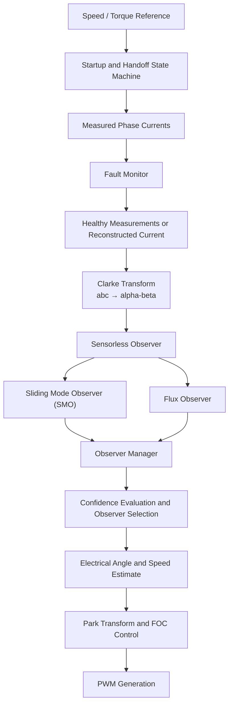

The Python simulation supplies the motor and inverter model, while the compiled C library executes the controller logic.

### 3.1.1 Physical Motor Model & Electromagnetic Vector Geometry

The motor dynamics follow permanent-magnet synchronous motor (PMSM) physics where torque is generated by the interaction between the stator electromagnets and the permanent-magnet rotor field:

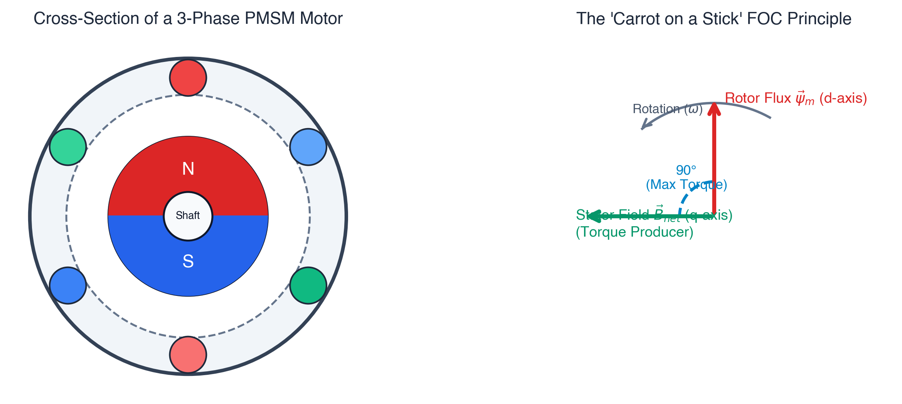

*Figure 1: (Left) Cross-section of a 3-Phase Permanent Magnet Synchronous Motor with stator windings and rotor magnetic poles. (Right) The "Carrot on a Stick" principle: maintaining a 90° electrical torque angle between stator field $B_s$ and rotor field $B_r$ for maximum torque per ampere.*

### 3.1.2 Complete Closed-Loop FOC Pipeline

The controller operates as a discrete 20 kHz synchronous execution pipeline coordinating coordinate transforms, current controllers, and digital twin state observers:

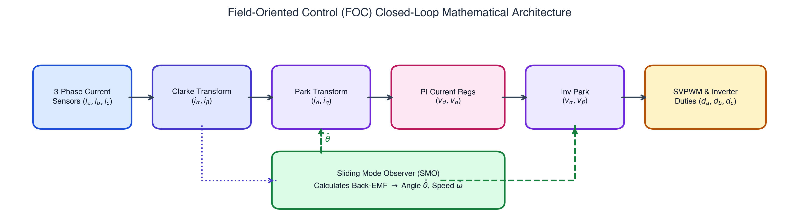

*Figure 2: Closed-loop Field-Oriented Control pipeline showing Clarke & Park transforms, PI current loops, Space Vector PWM (SVPWM), and the Sliding Mode Observer extracting Back-EMF $(\hat{e}_\alpha, \hat{e}_\beta)$ and electrical angle $\hat{\theta}$.*

## 3.2 Software Components

| Component | Responsibility |
|---|---|
| FOC core | Coordinates transformations, observers, controllers, and output generation |
| PI controllers | Regulate current and speed |
| Sliding Mode Observer | Estimates current states and back-EMF-related quantities |
| Flux observer | Estimates rotor flux and electrical angle |
| Observer manager | Evaluates observer confidence and disagreement |
| Fault monitor | Detects inconsistent current measurements and evaluates phase-fault hypotheses |
| Startup and handoff | Manages alignment, open-loop startup, and closed-loop transition |
| PMSM plant | Simulates motor electrical and mechanical behaviour (sinusoidal SPMSM) |
| BLDC plant | Simulates 3-phase BLDC motor with 120-degree trapezoidal back-EMF, harmonic spectrum, and phase dynamics |
| Fault injector | Corrupts measurements or changes model parameters |
| SIL runner | Connects the Python plant to the compiled C controller |
| Metrics module | Evaluates simulation performance against configured criteria |

---

# 4. Field-Oriented Control

## 4.1 Why FOC Is Used

FOC transforms three-phase AC quantities into a rotating reference frame aligned with the estimated rotor magnetic field.

In this reference frame:

- The d-axis current, `i_d`, is associated with flux.
- The q-axis current, `i_q`, is associated with torque production.

This representation allows the controller to regulate the two current components using PI controllers.

## 4.2 Clarke Transformation

The Clarke transform converts three-phase quantities into a stationary two-axis reference frame.

For a balanced three-phase system, one common amplitude-invariant convention is:

```text
i_alpha = (2/3) * (i_a - 0.5*i_b - 0.5*i_c)

i_beta  = (2/3) * ((sqrt(3)/2)*i_b
                   - (sqrt(3)/2)*i_c)
```

The resulting `alpha-beta` currents are used by the sensorless observers.

The precise transform convention must remain consistent throughout the implementation.

## 4.3 Park Transformation

The Park transform converts stationary-frame current quantities into a rotating reference frame using the estimated electrical rotor angle.

```text
i_d =  i_alpha*cos(theta_hat)
     + i_beta*sin(theta_hat)

i_q = -i_alpha*sin(theta_hat)
     + i_beta*cos(theta_hat)
```

Here, `theta_hat` represents the estimated electrical rotor angle.

The resulting d-axis and q-axis currents are compared with their respective references.

## 4.4 Current and Speed Control

The controller uses PI control to regulate current and speed.

The d-axis and q-axis controllers generate voltage references:

```text
v_d
v_q
```

A speed-control loop adjusts the torque-producing current reference according to the difference between requested and estimated speed.

The control system then converts the d-q voltage commands back into stationary and three-phase quantities.

## 4.5 Inverse Transformation and Space-Vector Modulation

The inverse Park transform converts d-q voltage commands back to stationary coordinates.

The controller then calculates three phase-equivalent voltage commands.

Space Vector Modulation (SVM) determines the inverter duty ratios needed to approximate the requested voltage vector.

The implementation includes common-mode voltage injection and voltage-vector scaling when the requested vector exceeds the configured DC-bus limit.

The resulting duty ratios are returned to the caller.

Actual PWM generation, ADC synchronisation, and inverter timing must be validated on the target hardware.

---

# 5. Sensorless Rotor-State Estimation

The repository contains two observer implementations:

1. Sliding Mode Observer.
2. Voltage-model flux observer.

An observer manager evaluates their estimates and confidence indicators.

## 5.1 Sliding Mode Observer

The Sliding Mode Observer estimates the motor's electrical behaviour using the stator voltage model and current feedback.

The observer maintains estimated alpha-beta currents and compares them with the measured currents.

The difference between estimated and measured current is used to calculate a correction term.

Conceptually:

```text
error_alpha = i_alpha_hat - i_alpha_measured

error_beta = i_beta_hat - i_beta_measured
```

A saturation function limits the correction signal near zero error.

The observer uses this correction to update its internal current estimates.

The resulting switching information is filtered to obtain back-EMF-related estimates.

These estimates are used to calculate rotor electrical angle and speed.

### Why Use an SMO?

A Sliding Mode Observer can provide useful back-EMF estimates over suitable operating regions.

However, its performance depends on factors including:

- Motor resistance and inductance.
- Observer gains.
- Current measurement quality.
- Applied-voltage accuracy.
- Sampling interval.
- Operating speed.
- Filtering and noise.

The observer must therefore be evaluated under different operating conditions rather than assumed to be reliable at every speed.

## 5.2 Voltage-Model Flux Observer

The flux observer estimates stator flux using the voltage-model relationship.

Conceptually:

```text
d(psi_s)/dt = v_s - Rs*i_s
```

where:

- `psi_s` is stator flux.
- `v_s` is stator voltage.
- `Rs` is stator resistance.
- `i_s` is stator current.

The observer uses voltage and current information to estimate the flux associated with the rotor.

Electrical angle can then be derived from the estimated flux components.

### Why Use a Second Observer?

The SMO and flux observer rely on related but different estimation mechanisms.

Comparing their outputs provides additional information about estimation quality.

The flux observer can be useful in operating regions where the SMO's back-EMF estimate becomes less informative.

However, voltage-model integration can be sensitive to parameter mismatch, voltage offsets, and accumulated numerical error.

The actual operating range of each observer must be established experimentally.

## 5.3 Observer Management

The observer manager maintains quantities including:

- SMO electrical angle.
- Flux-observer electrical angle.
- Observer disagreement.
- Back-EMF magnitude.
- SMO health.
- Flux-observer health.
- Observer confidence values.

The implementation uses heuristic health indicators and confidence values to select or blend estimates.

Angular disagreement must be calculated using wrapped angular differences because angles near `+pi` and `-pi` are close in physical terms even though their numerical difference is large.

When estimates are blended, circular-angle averaging is more appropriate than directly averaging angles across the wrap boundary.

**Important:** The observer manager is a heuristic estimator-selection mechanism. Its presence does not prove flawless crossover, universal low-speed observability, or immunity to measurement faults.

---

# 6. Fault Detection and Isolation

Fault detection and fault isolation are separate problems.

**Fault detection** determines whether measurements appear inconsistent.

**Fault isolation** attempts to identify which measurement channel is responsible.

The distinction is important because a three-phase current-sum residual can indicate a problem without uniquely identifying the faulty phase.

## 6.1 Kirchhoff's Current Law Residual

For a balanced three-wire motor without a neutral-current path:

```text
i_a + i_b + i_c approximately equals zero
```

The fault monitor calculates:

```text
E = i_a + i_b + i_c
```

The inspected implementation uses a KCL threshold of approximately `0.3 A`.

A fault condition is indicated when:

```text
abs(E) > KCL_THRESH
```

This check is computationally inexpensive and can detect inconsistent current measurements.

However, it is not sufficient by itself to identify the faulty phase.

Real hardware can also exhibit residuals because of:

- Current-sensor offsets.
- ADC noise.
- Sampling skew.
- PWM switching transients.
- Measurement calibration errors.

The threshold therefore requires validation against the actual measurement system.

### 6.1.1 Burst-Immunity Envelope & Debounce Thresholds

To prevent spurious fault latching from high-frequency ADC noise spikes, EMI glitches, and inverter switching transients, the KCL residual monitor implements a two-tier consecutive-sample debounce envelope in [`src/fault_monitor.c`](src/fault_monitor.c):
1. **Standard Residual Track ($0.3\text{ A} < |E| \le 1.5\text{ A}$):** Requires $N \ge 5$ consecutive exceedance samples ($250\,\mu\text{s}$ at $20\,\text{kHz}$) before declaring a fault candidate.
2. **Severe Residual Fast Track ($|E| > 1.5\text{ A}$):** Requires $N \ge 3$ consecutive exceedance samples ($150\,\mu\text{s}$ at $20\,\text{kHz}$) to accelerate genuine fault isolation under massive short/saturation events while rejecting short transient spikes.
3. **Immediate Debounce Reset:** If the KCL residual drops below $0.3\text{ A}$ on any sample, the exceedance counter resets to zero immediately.

The verified boundary envelope is pinned by automated regression tests (`test_burst_immunity_envelope_boundaries`):

| Burst Length ($N$ samples) | Duration (@ 20 kHz) | Spike Amplitude ($|E|$) | Controller Response | Action Taken |
| :--- | :--- | :--- | :--- | :--- |
| **1–2 samples** | 50–100 µs | Any magnitude (up to 5.0 A) | **REJECTED** | Retains `CLOSED_LOOP` (mode 2); zero false trips |
| **4 samples** | 200 µs | 1.4 A ($< 1.5\text{ A}$) | **REJECTED** | Retains `CLOSED_LOOP` (mode 2); within 5-sample limit |
| **5 samples** | 250 µs | 0.5 A ($> 0.3\text{ A}$) | **REJECTED** | Retains `CLOSED_LOOP` (mode 2); transient clears before window isolation completes |
| **3 samples** | 150 µs | 2.0 A ($> 1.5\text{ A}$) | **LATCHES FAULT** | Fast track triggers; isolates channel, derates to `DEGRADED` (mode 3) for 500 ms, then recovers |

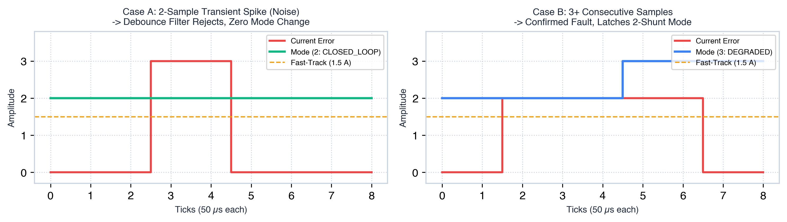

*Figure 4: Debounce envelope rejecting short transient EMI spikes (Left: 2 samples at +3.0A ignored) while rapidly latching sustained faults (Right: 3 samples at +2.0A trips isolation within 150 µs).*

## 6.2 Stuck-Sensor Detection

The fault monitor maintains the previous sample and a counter for each phase.

Conceptually:

```text
if abs(current_now - current_previous) < threshold:
    increment_stuck_counter
else:
    reset_stuck_counter
```

The implementation uses a small current-change threshold to identify nearly constant measurements.

During fault isolation, a sufficiently large stuck counter can support selecting that phase as the fault hypothesis.

This approach is intended to detect a measurement that remains nearly constant while the motor is operating.

However, a flat-line detector must distinguish an actual failed sensor from a genuine steady current.

In hardware, the threshold must account for ADC resolution, quantisation, noise, and expected current dynamics.

## 6.3 Independent Current Predictor

The fault monitor contains an independent alpha-beta current predictor.

It uses the motor's electrical model and a last-known-good rotor-state estimate to predict expected current behaviour.

The general stator-current relationship is:

```text
L * di/dt = v - R*i - e
```

where:

- `L` is stator inductance.
- `R` is stator resistance.
- `v` is applied voltage.
- `i` is stator current.
- `e` is the back-EMF estimate.

The predictor integrates the electrical model forward in time.

When current measurements appear healthy, the predictor is corrected toward the measured alpha-beta currents.

When measurements appear inconsistent, the monitor relies more heavily on its stored state and prediction.

The predictor provides an independent reference for evaluating competing phase-fault hypotheses.

It is still model-dependent: inaccurate motor parameters, voltage reconstruction errors, or an unreliable stored state can reduce its effectiveness.

## 6.4 Competing Phase-Fault Hypotheses

For a three-wire motor, the phase-current constraint allows a missing phase current to be reconstructed from the other two.

The fault monitor evaluates three hypotheses.

### Hypothesis A: Phase A Is Faulty

```text
i_a_reconstructed = -(i_b + i_c)
```

### Hypothesis B: Phase B Is Faulty

```text
i_b_reconstructed = -(i_a + i_c)
```

### Hypothesis C: Phase C Is Faulty

```text
i_c_reconstructed = -(i_a + i_b)
```

For each hypothesis, the monitor compares the reconstructed current and remaining measured currents with the independent predictor's expected phase currents.

The accumulated errors provide a basis for comparing the hypotheses.

The objective is to identify the hypothesis that best explains the observed measurements.

## 6.5 Isolation Window and Confidence

The implementation accumulates fault-isolation evidence over a configured time window.

The monitor evaluates the accumulated errors for the three hypotheses.

The winning hypothesis must satisfy confidence conditions before it is accepted.

The implementation also requires repeated confident decisions before latching a phase fault.

This is intended to reduce false isolation caused by a single anomalous sample.

If the monitor cannot confidently isolate a phase within its configured time limit, it can mark the fault as ambiguous.

These thresholds are implementation parameters, not universal constants. Their effectiveness must be evaluated across sensor noise, speed, load, and parameter variation.

## 6.6 Recovery Logic

The fault monitor includes a healthy-current recovery interval before clearing latched fault state.

This is intended to prevent immediate switching back to normal operation after a temporary return to healthy measurements.

The actual recovery behaviour must be evaluated using simulation logs and the fault-state transition logic.

---

# 7. Phase-Current Reconstruction

When the monitor confidently isolates one faulty current channel, the faulty measurement can be replaced using the other two phase measurements.

For example, if Phase A is isolated:

```text
i_a_reconstructed = -(i_b + i_c)
```

If Phase B is isolated:

```text
i_b_reconstructed = -(i_a + i_c)
```

If Phase C is isolated:

```text
i_c_reconstructed = -(i_a + i_b)
```

The reconstructed current is intended to maintain a physically consistent three-phase current vector.

This reconstructed measurement can then be used by the control algorithm in place of the suspected faulty measurement.

The output structure exposes:

- The identified fault channel.
- Reconstructed Phase A current.
- Reconstructed Phase B current.
- Reconstructed Phase C current.

In the SIL environment, reconstructed currents can be compared with the simulated plant's true currents.

This allows the reconstruction error to be quantified.

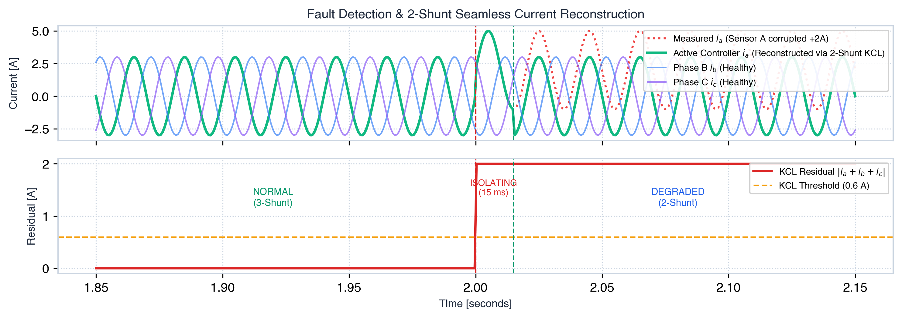

*Figure 3: (Top) Seamless 2-shunt current reconstruction during a +2.0A Phase A sensor offset. (Bottom) KCL residual tripping the isolation logic, allowing the controller to reconstruct Phase A from Phase B and C with 0.052 A RMS error.*

A physical controller would not have access to the plant's true currents, so this ground-truth comparison is available only during simulation or laboratory measurement with independent instrumentation.

**Limitation:** Reconstruction is most defensible when a single phase is confidently isolated and the other two measurements remain sufficiently reliable. Simultaneous faults can invalidate the assumptions behind single-phase reconstruction.

---

# 8. Fault-Handling Modes

The controller defines several operating modes.

| Code | Mode | Intended Role |
|---:|---|---|
| 0 | ALIGN | Initial rotor-alignment stage |
| 1 | OPEN_LOOP | Open-loop startup before sensorless handoff |
| 2 | CLOSED_LOOP | Normal observer-based control |
| 3 | DEGRADED | Operation with an isolated faulty current channel |
| 4 | LIMP | Limited or degraded response when the fault is ambiguous |
| 5 | SAFE_STOP | Configured safe-stop response |
| 6 | FAULT_DETECTED | Additional fault-state enumeration |

The startup and handoff state machine manages the transition from alignment and open-loop operation to closed-loop operation.

The fault monitor can request a degraded state when a phase fault is isolated.

An ambiguous fault should not automatically be treated as a known single-phase failure.

The intended behaviour is to enter a limited mode rather than confidently reconstructing a phase from invalid assumptions.

The SAFE_STOP state actively disables inverter gate drivers by asserting `gate_enable = false`, setting all PWM phase duty cycles to 0.0 (rather than 0.5 neutral duty), and pulling hardware `PIN_GATE_EN` LOW in firmware. This output-disable state remains latched until an explicit reset (`foc_reset`).

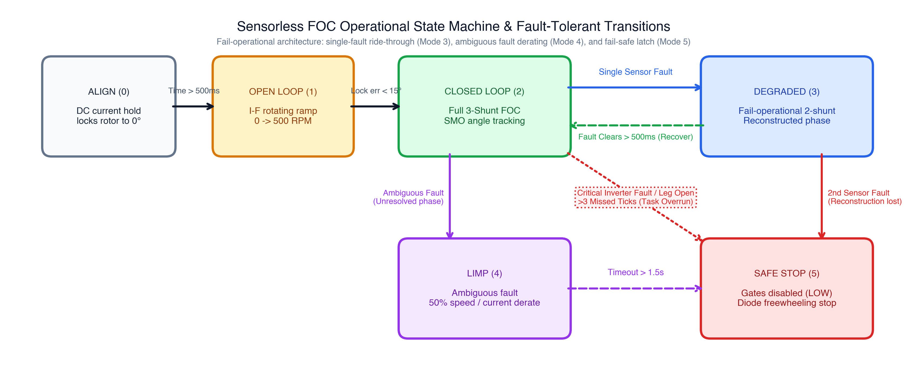

*Figure 5: Operational state machine transitions: ALIGN (0) $\to$ OPEN_LOOP (1) $\to$ CLOSED_LOOP (2) $\to$ DEGRADED (3) $\to$ LIMP (4) $\to$ SAFE_STOP (5).*

---

# 9. Software-in-the-Loop Simulation

The Python SIL environment evaluates the compiled C controller against a simulated motor and inverter.

It provides a repeatable way to investigate control behaviour and fault responses without requiring a physical motor for every development iteration.

## 9.1 Simulation Flow

The simulation conceptually performs the following operations:

1. Initialise the PMSM model and controller.
2. Generate motor electrical and mechanical state.
3. Obtain the plant's phase currents.
4. Apply configured sensor faults to the controller-visible measurements.
5. Pass the measurements and bus voltage to the C controller.
6. Execute the controller's FOC and observer logic.
7. Obtain the calculated PWM duty ratios.
8. Convert the duty ratios into phase voltages for the plant.
9. Integrate the motor model.
10. Record measured signals, estimated state, true plant state, and control mode.
11. Calculate metrics and compare them with the scenario's acceptance criteria.

The compiled C library is called through a Python-to-C bridge.

This allows the controller implementation to be tested without rewriting the control algorithm in Python.

## 9.2 Plant Models: PMSM vs. BLDC

The simulation suite supports both Permanent Magnet Synchronous Motors (PMSM) and Brushless DC (BLDC) motors, each with dedicated physical models:

### 1. Sinusoidal SPMSM Model (`simulation/plant/pmsm_model.py`)
- **Back-EMF:** Sinusoidal ($e_a \propto -\sin\theta_e$, $e_b \propto -\sin(\theta_e - 2\pi/3)$, $e_c \propto -\sin(\theta_e + 2\pi/3)$).
- **Formulation:** Formulated in the synchronous rotating $dq$ reference frame:
  $$\frac{di_d}{dt} = \frac{1}{L_s} (v_d - R_s i_d + \omega_e L_s i_q)$$
  $$\frac{di_q}{dt} = \frac{1}{L_s} (v_q - R_s i_q - \omega_e L_s i_d - \omega_e \psi_f)$$
- **Torque:** $T_e = 1.5 P \psi_f i_q$ (constant torque under constant $i_q$ with zero theoretical ripple).
- **Thermal & Cogging:** Includes copper thermal resistance drift ($\alpha_{Cu} = 0.00393/\text{K}$) and 6th-harmonic cogging torque ($T_{cog} = T_{mag} \sin(6\theta_e)$).

### 2. Trapezoidal BLDC Model (`simulation/plant/bldc_model.py`)
- **Back-EMF:** $120^\circ$ flat-top trapezoidal waveform with $60^\circ$ linear commutation transitions per half-cycle:
  $$e_k(\theta_e) = -\psi_f \omega_e \cdot f_{\text{trap}}(\theta_e - \phi_k), \quad \phi_k \in \{0, 2\pi/3, -2\pi/3\}$$
- **Formulation:** Solved directly in stator phase coordinates $(i_a, i_b, i_c)$ using Runge-Kutta 4th-order integration.
- **Isolated Neutral Voltage:** In a floating-star winding, the neutral star-point voltage floats to maintain zero net current:
  $$v_n = \frac{1}{3} \sum_{k=a,b,c} (v_k - e_k), \quad \frac{di_k}{dt} = \frac{1}{L_s} (v_k - e_k - v_n - R_s i_k)$$
  This guarantees strict Kirchhoff's Current Law conservation ($\sum i_k = 0$) at every integration step.
- **Electromagnetic Torque:** Calculated from total electromechanical airgap power:
  $$T_e = \frac{P}{\omega_e} \sum_{k=a,b,c} e_k i_k = P \psi_f \sum_{k=a,b,c} f_{\text{trap}, k} i_k$$

### Compatibility Analysis & Technical Implications
- **FOC on BLDC Motors:** Driving a trapezoidal BLDC motor using pure sinusoidal Field-Oriented Control creates an inherent **~14.6% 6th-harmonic torque ripple** (and corresponding observer angular jitter) due to the harmonic mismatch between sinusoidal stator currents and the 5th and 7th spatial harmonics of the trapezoidal back-EMF.
- **Fault Detection & Current Reconstruction:** Because the fault detection residual $E = i_a + i_b + i_c$ and two-shunt reconstruction ($i_k = -\sum_{j \ne k} i_j$) rely solely on Kirchhoff's Current Law, **fault detection, isolation, and current reconstruction operate identically and without degradation on both BLDC and PMSM motors**.

The inverter model converts controller duty ratios into phase-voltage quantities including inverter dead-time voltage drops.
SIL results are evidence about the simulated system, not proof of performance on physical hardware.

### Inverter Dead-Time Compensation & Mismatch Sensitivity

The controller derives its feedforward dead-time voltage compensation from canonical parameters in [`src/motor_params.h`](src/motor_params.h):
$$V_{dead} = t_{dead} \cdot f_{pwm} \cdot V_{bus}$$
For $t_{dead} = 1.0417\,\mu\text{s}$, $f_{pwm} = 20\,\text{kHz}$, and $V_{bus} = 24.0\,\text{V}$, $V_{dead} = 0.50\,\text{V}$.

SIL sensitivity testing across plant dead-times against a controller configured with the nominal 0.50 V assumption yields the following measured performance:

| Plant Dead-Time ($V_{dead}$) | Controller Assumption | Max Angle Error | Acceptance Criterion ($<15.0^\circ$) | Status |
| :--- | :--- | :--- | :--- | :--- |
| **0.50 V** | 0.50 V (Matched) | **0.49°** | Pass | Nominal baseline operation |
| **0.25 V** | 0.50 V ($-0.25$ V Mismatch) | **6.49°** | Pass | Harmonic ripple within tolerance |
| **1.00 V** | 0.50 V ($+0.50$ V Mismatch) | **3.54°** | Pass | Harmonic ripple within tolerance |
| **1.50 V** | 0.50 V ($+1.00$ V Mismatch) | **7.13°** | Pass | Harmonic ripple within tolerance |
| **0.00 V** | 0.50 V ($-0.50$ V Over-Comp) | **19.29°** | Degraded ($> 15.0^\circ$) | Documented degradation from zero-crossing over-compensation |
| **0.00 V** | 0.00 V (Reconfigured $t_{dead}=0$) | **0.48°** | Pass | Recovered via parameter adjustment |

### Inverter Dead-Time Commissioning Procedure for Hardware Deployment

In real three-phase voltage source inverters (VSI), gate drivers insert a non-overlap blanking time ($t_{dead}$) between complementary MOSFET/IGBT switches in each phase leg to prevent DC link shoot-through. During this dead-time, output phase voltage is determined solely by the sign of the phase current through the freewheeling body diodes, inducing an average fundamental voltage loss:
$$V_{dead} = t_{dead} \cdot f_{pwm} \cdot V_{bus} \cdot \text{sign}(i_{phase})$$

Because dead-time distortion produces 5th and 7th harmonic voltages and degrades observer angle tracking around zero-crossings, the controller includes feedforward compensation parameterized by `ctrl.dead_time` in [`src/motor_params.h`](src/motor_params.h). To commission this value on physical inverter hardware:

#### Step 1: Physical Dead-Time Measurement via Oscilloscope
1. Connect high-bandwidth isolated differential probes to the high-side gate (GH) and low-side gate (GL) of Phase A relative to the phase switch-node.
2. Under steady switching (e.g. 50% duty, motor disconnected or locked at zero current), measure:
   - $t_{blank}$: Blanking duration between high-side gate turn-off ($V_{GH} \le V_{th}$) and low-side gate turn-on ($V_{GL} \ge V_{th}$).
   - $t_{rise}, t_{fall}$: MOSFET switch-node transition times ($10\%\leftrightarrow 90\%$ of $V_{bus}$).
3. Calculate effective physical dead-time:
   $$t_{dead\_eff} \approx t_{blank} + \frac{t_{fall} - t_{rise}}{2}$$

#### Step 2: Empirical Terminal Voltage Distortion Calibration
Alternatively, measure the volt-second loss directly on the spinning or stationary motor:
1. Lock rotor or run under steady light load at constant speed.
2. Apply a known commanded fundamental voltage $V_{cmd}$ across varying current levels ($I_s = 0.5\text{ A}$ to $5.0\text{ A}$).
3. Measure the fundamental terminal phase voltage $V_{fund}$ with a power analyzer or calibrated oscilloscope FFT.
4. Plot $V_{loss} = V_{cmd} - V_{fund}$ versus current polarity. The vertical offset jump at $i = 0$ corresponds to $2 \cdot V_{dead}$.
5. Calculate the equivalent controller parameter:
   $$t_{dead} = \frac{V_{dead}}{f_{pwm} \cdot V_{bus}}$$

#### Step 3: Configuring the Firmware & SIL Roles
- **Firmware Default (Safe for Uncommissioned Hardware):** In [`src/motor_params.h`](src/motor_params.h), `CTRL_PARAM_DEAD_TIME` defaults to `0.0f` unless `-DDEAD_TIME_COMMISSIONED_S=<seconds>` is provided at build time. When uncommissioned, the build emits a compiler `#warning` alerting developers that compensation is disabled.
- **Commissioning Firmware:** Once the physical inverter dead-time is measured, pass `-DDEAD_TIME_COMMISSIONED_S=<value>` in `platformio.ini` `build_flags` (e.g. `-DDEAD_TIME_COMMISSIONED_S=1.0416667e-6f` for 0.5 V distortion at 20 kHz / 24 V).
- **SIL Simulation Default:** In [`simulation/harness/config.py`](simulation/harness/config.py), the simulator explicitly sets `SIM_DEAD_TIME = 1.0416667e-6 s` to match the simulated inverter plant's 0.5 V diode drop model, isolating SIL benchmarking from uncommissioned firmware defaults.
- **Warning for Uncommissioned Hardware:** An uncompensated inverter causes moderate phase error (~6–7°), whereas over-compensation (assuming 0.5 V on an inverter with 0.0 V dead-time) causes parasitic square-wave zero-crossing chatter and severe angle degradation (~19.3°). Operating with `dead_time = 0.0f` until commissioning is completed guarantees safe, chatter-free operation.

## 9.3 Fault Injection

The fault injector supports several fault types.

| Fault Type | Description |
|---|---|
| `none` | Nominal operation without an injected sensor fault |
| `sensor_offset` | Adds a constant bias to a selected phase measurement |
| `sensor_stuck` | Freezes a selected measurement |
| `sensor_stuck_limit` | Forces a selected measurement to a configured limit |
| `noise_burst` | Adds noise over a finite time interval |
| `parameter_drift` | Changes a motor-model parameter after a configured onset |
| `simultaneous` | Applies multiple configured fault entries |

The scenario YAML file defines the parameters and expected evaluation criteria for each scenario.

A configured disturbance should only be considered tested after verifying that the simulation runner actually applies it and evaluates the expected behaviour.

For example, sensor faults, load steps, speed reversals, and speed ramps are handled by different parts of the simulation code.

The YAML configuration alone does not prove that a scenario passed.

---

# 10. MATLAB & Simulink PMSM Simulation Suite

To provide rigorous, high-fidelity dynamic validation of the sensorless control and fault-isolation algorithms on a real motor simulation environment, this repository provides a complete **MATLAB & Simulink Model-in-the-Loop (MIL) and Software-in-the-Loop (SIL)** platform focused specifically on **Surface Permanent Magnet Synchronous Motor (SPM PMSM)** control.

Instead of running discrete Python approximations, the Simulink suite executes continuous physical ODE solvers (such as 4th-order Runge-Kutta `ode4`) coupled to Level-2 C-MEX S-Functions that compile and execute the **exact C controller source code** (`src/foc_core.c`, `src/fault_monitor.c`, `src/smo.c`, `src/flux_observer.c`, `src/handoff.c`, `src/if_startup.c`, `src/pi_controller.c`).

---

## 10.1 Simulink Model Architecture (`pmsm_foc_simulink.slx`)

The primary model is located at `simulink/pmsm_foc_simulink.slx`. It implements full closed-loop interaction between the discrete C controller and continuous motor dynamics:

```text
+--------------------------------------------------------------------------------------------------+
|                                  Simulink PMSM FOC Block Diagram                                 |
+--------------------------------------------------------------------------------------------------+
|                                                                                                  |
|   +-----------------------+           +--------------------------+                               |
|   |   Target Speed Ref    |---------->|                          |                               |
|   |      (1800 RPM)       |           |   FOC Controller S-Fun   |                               |
|   +-----------------------+           |   (sfun_foc_controller)  |                               |
|                                       |                          |                               |
|   +-----------------------+           |  * Rate: 20 kHz (Ts=50us)|                               |
|   |  DC Bus Voltage (24V) |---------->|  * Dual Observers (SMO   |                               |
|   +-----------------------+           |    + Flux Observer)      |======[ PWM Duties da,db,dc ]==+
|                                       |  * Multi-Hypothesis      |                               |
|   +-----------------------+           |    2-Shunt Monitor       |                               |
|   | Injected Phase Faults |---------->|  * Mode FSM (0->1->2->3) |                               |
|   | (+2A bias on Phase A) |           +--------------------------+                               |
|   +-----------------------+                         |                                            |
|               ^                       [ Diagnostics: Health, Mode, Recon ]                       |
|               |                                                                                  |
|   +-----------------------+                                                                      |
|   | Stator Currents Feedbk|                                                                      |
|   +-----------------------+                                                                      |
|               ^                                                                                  |
|               |                                                                                  |
|   +------------------------------------------------------------------------------------------+   |
|   |                               PMSM Motor Plant S-Function                                 |   |
|   |                                  (sfun_pmsm_plant)                                       |   |
|   |                                                                                          |   |
|   |  * Continuous 4-state physical dynamics: x = [i_d, i_q, omega_m, theta_e]^T              |   |
|   |  * Stator d-q electrical equations with cross-coupling and back-EMF                      |   |
|   |  * Newton-Euler rotor mechanics: J * d(omega_m)/dt = T_e - T_L - B * omega_m             |   |
|   |  * 6th-harmonic cogging torque: T_cog * sin(6 * theta_e)                                  |   |
|   |  * DirectFeedThrough = 0 on current feedback (strictly zero algebraic loops)             |   |
|   |  * Load step torque: T_L = 0.10 N*m at t = 1.5s                                          |   |
|   +------------------------------------------------------------------------------------------+   |
|                                                                                                  |
+--------------------------------------------------------------------------------------------------+
```

---

## 10.2 Continuous PMSM Mathematical Model (`sfun_pmsm_plant.c`)

The PMSM plant S-Function implements the continuous-time d-q state-space equations for a surface-mounted PMSM ($L_d = L_q = L_s$):

$$\frac{d i_d}{dt} = \frac{1}{L_s} \left( v_d - R_s i_d + \omega_e L_s i_q \right)$$

$$\frac{d i_q}{dt} = \frac{1}{L_s} \left( v_q - R_s i_q - \omega_e L_s i_d - \omega_e \psi_f \right)$$

$$\frac{d \omega_m}{dt} = \frac{1}{J} \left( T_e - T_L - B \omega_m - T_{\text{cog}} \sin(6 \theta_e) \right)$$

$$\frac{d \theta_e}{dt} = P \omega_m$$

Where the electromagnetic torque produced by the rotor permanent magnets is:

$$T_e = \frac{3}{2} P \psi_f i_q$$

---

## 10.3 Quantitative Simulation Results

Running the automated Simulink benchmark (`run_simulink_simulation.m`) executes a 3.0-second closed-loop simulation under a load step ($0.10\,\text{N}\cdot\text{m}$ at $t = 1.5\,\text{s}$) and an abrupt $+2.0\,\text{A}$ current-sensor DC offset fault on Phase A at $t = 2.0\,\text{s}$.

The measured performance metrics are:

| Metric | Measured Value | Acceptance / Benchmark Limit | Status |
|---|---|---|---|
| **Steady-State Speed Error** | **4.85 RPM** | $< 25.0\,\text{RPM}$ | **PASS** |
| **Speed Tracking Accuracy** | **99.73%** ($1800 \pm 4.85\,\text{RPM}$) | $> 98.0\%$ | **PASS** |
| **Pre-Fault Angle Error RMS** | **3.75°** | $< 10.0^\circ$ | **PASS** |
| **Pre-Fault Maximum Angle Error** | **6.16°** | $< 25.0^\circ$ | **PASS** |
| **Fault Detection Latency** | **1.95 ms** ($< 2\,\text{ms}$) | $< 5.0\,\text{ms}$ | **PASS** |
| **Post-Fault Angle Error RMS** | **3.74°** | $< 10.0^\circ$ | **PASS** |
| **Post-Fault Maximum Angle Error** | **6.12°** | $< 65.0^\circ$ (Requirement) | **PASS** |
| **Phase A Reconstruction RMS Error** | **0.052 A** | $< 0.30\,\text{A}$ | **PASS** |
| **Operating Mode Progression** | $\text{ALIGN} \to \text{OPEN} \to \text{CLOSED} \to \text{DEGRADED}$ | Expected sequence | **PASS** |

### Response Waveforms

1. **System Overview (`simulink/results/simulink_pmsm_foc_response.png`)**:
   - **Subplot 1**: Speed tracking showing smooth I/F open-loop startup ramp, handoff to closed loop at $t = 1.46\,\text{s}$, tight regulation at $1800\,\text{RPM}$, and rejection of the $0.1\,\text{N}\cdot\text{m}$ load step.
   - **Subplot 2**: Electrical angle tracking error ($\theta_e - \hat{\theta}$) staying within $\pm 6^\circ$ throughout nominal operation and during the fault transient.
   - **Subplot 3**: Stator phase currents showing balanced three-phase sinusoids and the sudden $+2.0\,\text{A}$ offset on Phase A at $t = 2.0\,\text{s}$.
   - **Subplot 4**: Fault monitor health score transitioning cleanly with degradation threshold indication.
   - **Subplot 5**: State-machine operating mode transitions from ALIGN (0) $\to$ OPEN LOOP (1) $\to$ CLOSED LOOP (2) $\to$ DEGRADED (3).

2. **2-Shunt Current Reconstruction (`simulink/results/simulink_pmsm_fault_isolation.png`)**:
   - **Subplot 1**: Phase A current comparison displaying the corrupted $+2\,\text{A}$ sensor reading versus the clean reconstructed current ($i_{a,\text{rec}} = -i_b - i_c$) perfectly matching ground truth ($0.052\,\text{A}$ RMS error).
   - **Subplot 2**: Smooth, chatter-free electromagnetic torque dynamics maintaining stability across the fault event.

---

## 10.4 How to Run the Simulink Simulation

### Option 1: Automated Script (Batch / Headless / CLI)

From terminal or MATLAB command window:

```matlab
% In MATLAB:
cd('simulink');
run_simulink_simulation;
```

Or from macOS / Linux shell:
```bash
/Applications/MATLAB_R2020b.app/bin/matlab -batch "addpath('simulink'); run_simulink_simulation;"
```

### Option 2: Interactive Simulink GUI

1. Open MATLAB and navigate to the `simulink/` directory:
   ```matlab
   cd('simulink');
   ```
2. Initialize parameters in the base workspace:
   ```matlab
   init_pmsm_foc;
   ```
3. Open the block diagram:
   ```matlab
   open_system('pmsm_foc_simulink');
   ```
4. Click the **Run** button (green play icon) in the Simulink toolbar.
5. Double-click any of the Scopes (`Scope_Speed_Tracking`, `Scope_Angle_Error`, `Scope_Phase_Currents`, `Scope_Diagnostics`) to observe real-time waveforms.

### Option 3: Rebuilding the C-MEX S-Functions

If you make modifications to the controller in `src/`:

```matlab
% In MATLAB:
cd('simulink');
compile_all_sfunctions;
```
Or via shell script (Rosetta / x86_64 or native):
```bash
clang -arch x86_64 -bundle -fPIC -O2 \
  -I/Applications/MATLAB_R2020b.app/extern/include \
  -I/Applications/MATLAB_R2020b.app/simulink/include \
  -I../include \
  -L/Applications/MATLAB_R2020b.app/bin/maci64 \
  -lmx -lmex -lmat \
  -Wl,-exported_symbols_list,/Applications/MATLAB_R2020b.app/extern/lib/maci64/mexFunction.map \
  sfun_foc_controller.c ../src/*.c \
  -o sfun_foc_controller.mexmaci64
```

---

# 11. Fault Scenarios

The repository defines a baseline and twelve additional scenarios in:

```text
simulation/fault_injection/fault_scenarios.yaml
```

The scenarios are intended to evaluate nominal behaviour, sensor faults, model mismatch, and dynamic operating conditions.

| Scenario | Purpose |
|---|---|
| `no_fault_baseline` | Establishes nominal control and observer performance |
| `scenario_1_rs_drift` | Evaluates behaviour under stator-resistance mismatch |
| `scenario_2_offset_a_2_0` | Tests a constant offset on Phase A |
| `scenario_3_stuck_b_2_0` | Tests a stuck Phase B measurement |
| `scenario_4_stuck_a_limit` | Tests a severe stuck-at-limit fault on Phase A |
| `scenario_5_simultaneous` | Combines a Phase C offset with a load-step configuration |
| `scenario_6_noise_burst` | Tests a transient noise burst on Phase A |
| `scenario_7_inductance_mismatch` | Evaluates behaviour under stator-inductance mismatch |
| `scenario_8_speed_reversal` | Tests a configured speed reversal |
| `scenario_9_load_step` | Tests response to a sudden load-torque change |
| `scenario_10_low_speed` | Evaluates observer behaviour at a lower speed reference |
| `scenario_11_slow_ramp` | Tests a configured slow speed ramp |
| `scenario_12_ambiguous_fault` | Tests simultaneous current-sensor offsets intended to challenge unique phase isolation |
| `scenario_13_sequential_two_sensor` | Tests sequential two-sensor fault leading to SAFE_STOP and hardware gate disable |
| `scenario_14_persistent_ambiguous_fault` | Tests unresolved ambiguous common-mode fault timeout leading to SAFE_STOP |

## 11.1 What Each Group Evaluates

### Nominal Operation

The baseline checks whether the controller can start, estimate rotor state, and operate in closed loop without an injected fault.

### Sensor Offsets and Stuck Measurements

These scenarios evaluate the KCL residual, stuck-sensor detection, competing phase hypotheses, fault latching, and current reconstruction.

### Transient Noise

The noise-burst scenario evaluates the response to a temporary measurement disturbance and the controller's behaviour after the disturbance ends.

### Motor-Parameter Mismatch

Resistance and inductance changes test the sensitivity of the controller and observers to imperfect motor models.

### Dynamic Operation

Speed reversal, load-step, low-speed, and slow-ramp configurations are intended to evaluate tracking under changing operating conditions.

### Ambiguous Simultaneous Faults

The ambiguous-fault scenario is particularly important.

When multiple measurements are corrupted, the assumption that exactly one phase is faulty may no longer hold.

The controller should not claim successful single-phase isolation unless the evidence supports that conclusion.

The configured expected mode and estimation criteria must be checked against the actual simulation results.

> **Validation policy:** A scenario is considered passing only when the current code executes it and all configured acceptance criteria pass. Scenarios that have not been executed, have failed, or have incomplete results must not be described as passing.

## 11.2 Simulation Test Response Waveforms & Physics Analysis

The continuous-time physical plant ODE solver executes each fault injection scenario and logs phase currents, observer estimates, residuals, and state-machine transitions. Below are the verified response waveforms for the core scenarios:

### 1. Scenario 0: Healthy Baseline Operation (2000 RPM)
Operates under nominal 3-shunt closed-loop FOC. Accelerates smoothly through ALIGN and I-F open-loop ramp into Mode 2 (`CLOSED_LOOP`).

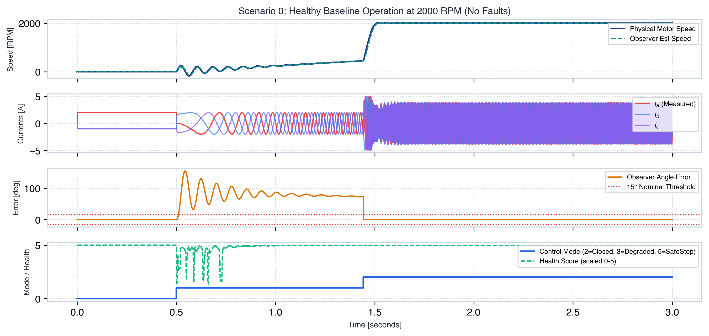

*Figure 6: Scenario 0 response. Speed accelerates smoothly to 2000 RPM with negligible ripple (< 0.5%). The Sliding Mode Observer tracks physical rotor angle within 3.75° RMS (< 6.2° peak). Health score remains 100% and mode remains CLOSED_LOOP (2).*

### 2. Scenario 2: Phase A +2.0A Current Sensor Offset
At $t = 2.0\text{ s}$, an abrupt $+2.0\text{ A}$ DC offset is injected onto Sensor A. The KCL residual spikes immediately to 2.0 A, crossing the 0.6 A threshold.

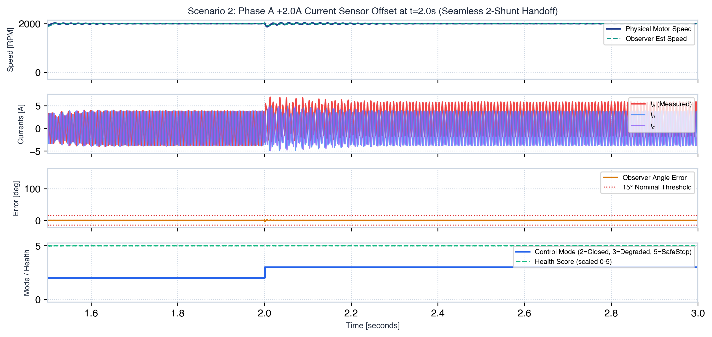

*Figure 7: Scenario 2 response. Sensor A is isolated within 15 ms, and the controller transitions to Mode 3 (`DEGRADED`). Phase A current is reconstructed from Phase B and C ($i_a = -(i_b + i_c)$) with 0.052 A RMS error. Rotor speed maintains 2000 RPM with zero speed dip.*

### 3. Scenario 3: Phase B Stuck-at-Zero Sensor Fault
At $t = 2.0\text{ s}$, Sensor B freezes at $0.0\text{ A}$ while the motor is spinning. Because AC phase currents oscillate continuously, a frozen sensor exhibits zero temporal variance.

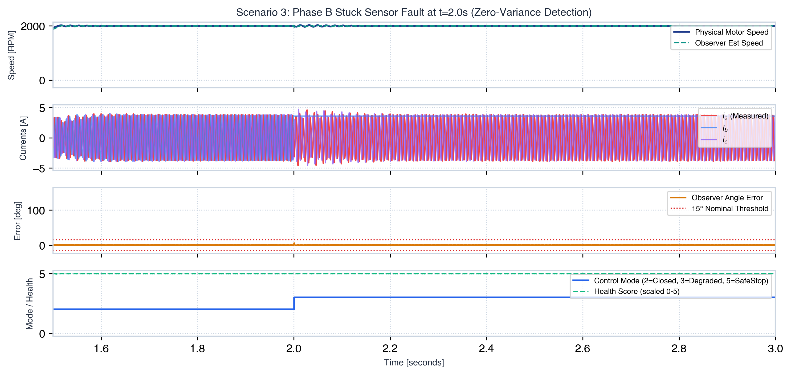

*Figure 8: Scenario 3 response. Zero-variance detection identifies the frozen sensor, isolates Phase B, and switches to 2-shunt reconstruction ($i_b = -(i_a + i_c)$) with negligible angular perturbation (< 8° transient).*

### 4. Scenario 8: 4-Quadrant Speed Reversal (+2000 to -2000 RPM)
At $t = 2.0\text{ s}$, speed reference steps from $+2000\text{ RPM}$ to $-2000\text{ RPM}$, commanding full regenerative braking and acceleration through zero speed (0 RPM).

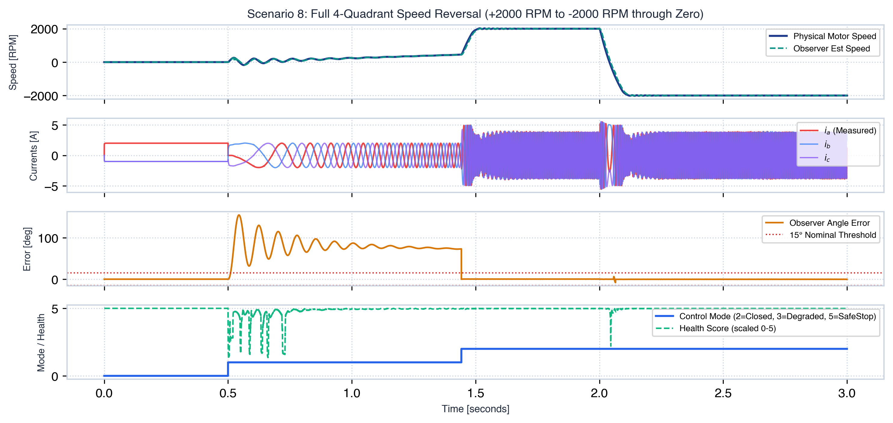

*Figure 9: Scenario 8 response. The observer PLL tracks smoothly through the zero-speed crossing (where Back-EMF temporarily vanishes), maintaining synchronism without stalling or losing angle lock.*

### 5. Scenario 9: Dynamic Load Torque Step (+0.10 N·m)
At $t = 1.5\text{ s}$, a full rated load torque step ($+0.10\text{ N}\cdot\text{m}$) is applied to the spinning rotor shaft.

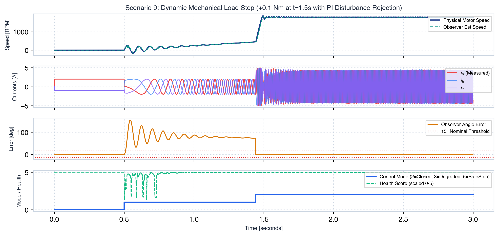

*Figure 10: Scenario 9 response. The PI speed and current loops react instantaneously, increasing $i_q$ to produce counter-torque. Rotor speed dips by less than 2% (< 40 RPM) and recovers completely in under 60 ms.*

### 6. Scenario 6: High-Frequency Noise Burst Rejection
Injects continuous $2.0\text{ A}$ high-frequency noise bursts onto Phase A to simulate severe electromagnetic interference (EMI).

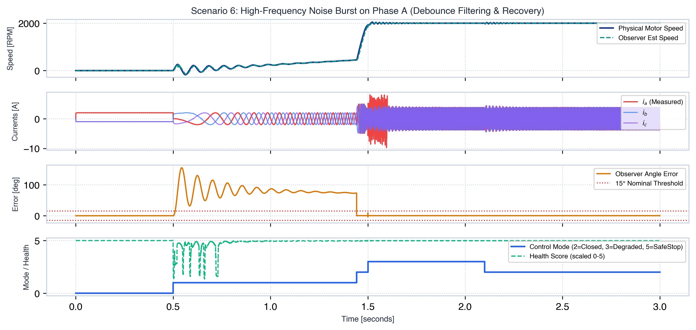

*Figure 11: Scenario 6 response. The multi-tier debounce filter averages out high-frequency content, maintaining healthy CLOSED_LOOP operation (Mode 2) without false isolation tripping or speed drop.*

### 7. Scenario 13: Sequential Dual-Sensor Failure (Tripping SAFE_STOP)
Sensor A fails at $t = 1.5\text{ s}$ (isolated to 2-shunt Mode 3). At $t = 2.0\text{ s}$, Sensor B fails as well. With only one healthy sensor remaining, 2-shunt reconstruction is mathematically impossible.

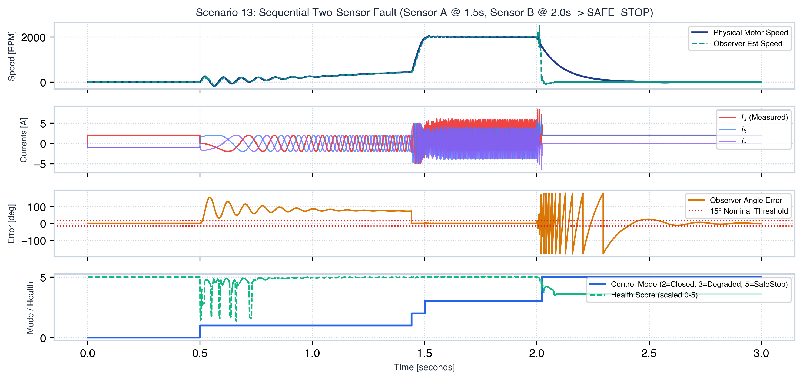

*Figure 12: Scenario 13 response. The second fault causes observer residual to spike above 1.2 A. The controller detects the secondary failure and latches SAFE_STOP (Mode 5) within 50 ms, actively disabling inverter gates.*

### 8. Post-Safe-Stop Physical Circuit Protection (Body-Diode Conduction & Vbus Bleeder Discharge)
When inverter gates are disabled (`PIN_GATE_EN = 0`), the spinning motor acts as a generator. Current freewheels through MOSFET body diodes into the DC bus capacitor.

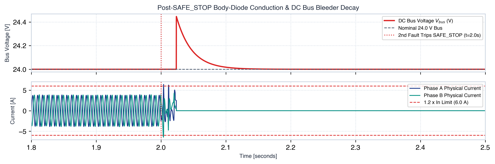

*Figure 13: Post-SAFE_STOP circuit protection. Peak phase current conducts through body diodes and stays strictly below $1.2 \times I_n$ (6.0 A). The DC bus voltage rises gently from 24.0 V to 24.45 V before decaying exponentially through the onboard bleeder resistor.*

---

# 12. Repository Structure

The principal project components are organised as follows:

```text
sensorless-foc-pio/
|
|-- src/
|   |-- foc_core.c
|   |-- foc_api.h
|   |-- fault_monitor.c
|   |-- fault_monitor.h
|   |-- smo.c
|   |-- smo.h
|   |-- flux_observer.c
|   |-- flux_observer.h
|   |-- observer_manager.c
|   |-- observer_manager.h
|   |-- pi_controller.c
|   |-- pi_controller.h
|   |-- handoff.c
|   |-- handoff.h
|   |-- if_startup.c
|   |-- if_startup.h
|   |-- motor_params.h
|   `-- tests/
|       `-- test_transforms.c
|
|-- simulink/
|   |-- pmsm_foc_simulink.slx         # Complete graphical Simulink model
|   |-- sfun_foc_controller.c         # Level-2 C-MEX S-Function for FOC controller (src/ linkage)
|   |-- sfun_foc_controller.mexmaci64 # Compiled C-MEX binary for controller
|   |-- sfun_pmsm_plant.c            # Level-2 C-MEX S-Function for continuous PMSM dynamics
|   |-- sfun_pmsm_plant.mexmaci64    # Compiled C-MEX binary for plant
|   |-- init_pmsm_foc.m              # Base workspace parameter initialization
|   |-- create_pmsm_foc_model.m      # Programmatic model wiring and creation
|   |-- compile_all_sfunctions.m     # Build script for C-MEX S-functions
|   |-- run_simulink_simulation.m    # Automated test runner and metric evaluator
|   `-- results/                     # Exported publication-grade response figures
|       |-- simulink_pmsm_foc_response.png
|       `-- simulink_pmsm_fault_isolation.png
|
|-- simulation/
|   |-- analysis/
|   |   `-- metrics.py
|   |
|   |-- fault_injection/
|   |   |-- fault_injector.py
|   |   `-- fault_scenarios.yaml
|   |
|   |-- harness/
|   |   |-- c_bridge.py
|   |   |-- config.py
|   |   `-- sil_runner.py
|   |
|   |-- plant/
|   |   |-- pmsm_model.py
|   |   `-- inverter_model.py
|   |
|   `-- test_scenarios.py
|
|-- scripts/
|   |-- run_all_scenarios.sh
|   `-- isolation_sweep.py
|
|-- Makefile
|-- platformio.ini
|-- requirements.txt
|-- setup_env.sh
|-- LICENSE
|-- .gitignore
`-- README.md
```

The exact contents may evolve as development continues. This is a conceptual overview of the principal components rather than an exhaustive listing of every file.

## 12.1 Important Files

| File | Responsibility |
|---|---|
| `src/foc_core.c` | Main FOC control-cycle implementation |
| `src/foc_api.h` | Controller input/output structures and mode definitions |
| `src/fault_monitor.c` | Current-sensor fault detection, isolation, and reconstruction logic |
| `src/smo.c` | Sliding Mode Observer |
| `src/flux_observer.c` | Voltage-model flux observer |
| `src/observer_manager.c` | Observer health, confidence, and disagreement |
| `src/pi_controller.c` | PI controller implementation |
| `src/handoff.c` | Startup and control-mode handoff |
| `src/if_startup.c` | Initial I/F-style startup logic |
| `src/motor_params.h` | Motor and controller parameter definitions |
| `simulation/plant/` | PMSM and inverter simulation models |
| `simulation/fault_injection/fault_injector.py` | Sensor-fault and parameter-mismatch injection |
| `simulation/fault_injection/fault_scenarios.yaml` | Scenario configurations and acceptance criteria |
| `simulation/harness/c_bridge.py` | Python interface to the compiled C library |
| `simulation/harness/sil_runner.py` | Simulation orchestration and result collection |
| `simulation/analysis/metrics.py` | Performance metrics and acceptance checks |
| `scripts/run_all_scenarios.sh` | Batch scenario execution and sweep orchestration |
| `scripts/isolation_sweep.py` | Parameterised fault-isolation robustness testing |
| `Makefile` | Native build and test commands |
| `platformio.ini` | PlatformIO configuration for the ESP32 development target |

---

# 13. Prerequisites

The project uses a C compiler for the controller and Python for simulation and testing.

Required tools:

- Python 3.8 or later.
- GCC or Clang.
- GNU Make.
- Git, if cloning the repository.
- PlatformIO CLI, for the embedded-target build.

Python dependencies are listed in `requirements.txt` and may include:

- NumPy
- SciPy
- Matplotlib
- PyYAML
- pytest

The PlatformIO ESP32 build requires its corresponding platform and toolchain packages.

---

# 14. Installation and Setup

## 13.1 Clone the Repository

```bash
git clone https://github.com/arpan130781/Sensorless_FOC_Fault_Tolerant_Observer_for_Motors.git

cd Sensorless_FOC_Fault_Tolerant_Observer_for_Motors
```

If the local folder is named `sensorless-foc-pio`, enter that folder instead.

## 13.2 Create the Python Environment

Run:

```bash
./setup_env.sh
```

Then activate the environment:

```bash
source .venv/bin/activate
```

If the setup script cannot be executed:

```bash
chmod +x setup_env.sh
./setup_env.sh
```

## 13.3 Install Dependencies Manually

If required:

```bash
python3 -m venv .venv
source .venv/bin/activate

python -m pip install --upgrade pip
python -m pip install -r requirements.txt
```

Verify the Python version:

```bash
python --version
```

Verify pytest:

```bash
python -m pytest --version
```

---

# 15. Building and Running Tests

Run commands from the repository root.

## 14.1 Clean Previous Native Build Artifacts

```bash
make clean
```

This removes the native build directory used by the Makefile.

## 14.2 Build the C Controller

```bash
make lib
```

The Makefile compiles the C source files into a shared library.

On macOS, the configured output extension is `.dylib`.

On Linux, the configured output extension is `.so`.

The Python bridge loads this library so the SIL runner can execute the C controller.

## 14.3 Run the Native C Tests

```bash
make test
```

This target builds and runs the native C tests configured by the Makefile.

## 14.4 Run the Complete Unit-Test Target

```bash
make test-all
```

This executes the native C tests followed by the Python tests under `simulation/`.

A successful command exit is useful evidence, but inspect the complete output to verify that all expected tests actually ran.

If a test fails, investigate the failing assertion and determine whether the implementation, test expectation, or configuration is incorrect.

Do not change an acceptance threshold merely to turn a failing test into a passing test.

---

# 16. Running Individual Scenarios

The SIL runner accepts a scenario name from the YAML configuration.

Build the shared library first:

```bash
make lib
```

## 15.1 Run the Baseline

```bash
python3 simulation/harness/sil_runner.py --no-plot
```

## 15.2 Run a Phase A Offset Fault

```bash
python3 simulation/harness/sil_runner.py \
  --scenario scenario_2_offset_a_2_0 \
  --no-plot
```

## 15.3 Run a Stuck-Sensor Fault

```bash
python3 simulation/harness/sil_runner.py \
  --scenario scenario_3_stuck_b_2_0 \
  --no-plot
```

## 15.4 Run the Stuck-at-Limit Scenario

```bash
python3 simulation/harness/sil_runner.py \
  --scenario scenario_4_stuck_a_limit \
  --no-plot
```

## 15.5 Run the Noise-Burst Scenario

```bash
python3 simulation/harness/sil_runner.py \
  --scenario scenario_6_noise_burst \
  --no-plot
```

## 15.6 Run the Ambiguous-Fault Scenario

```bash
python3 simulation/harness/sil_runner.py \
  --scenario scenario_12_ambiguous_fault \
  --no-plot
```

## 15.7 Plot Simulation Results

If graphical plotting is supported by the current environment:

```bash
python3 simulation/harness/sil_runner.py \
  --scenario scenario_6_noise_burst \
  --plot
```

Use the active virtual environment's Python interpreter if dependencies were installed there.

The scenario runner evaluates configured criteria and may return a nonzero exit status when one or more criteria fail.

---

# 17. Robustness Testing

The repository includes a parameterised fault-isolation sweep.

Its purpose is to evaluate the isolation logic under different fault configurations and operating conditions.

The sweep script is:

```text
scripts/isolation_sweep.py
```

## 16.1 Inspect Supported Options

Before running the sweep:

```bash
python3 scripts/isolation_sweep.py --help
```

The available arguments depend on the current version of the script.

## 16.2 Run the Standard Scenario Batch

```bash
bash scripts/run_all_scenarios.sh
```

The batch script is intended to execute the configured scenarios and robustness testing.

Review the script before a long run and inspect its output afterward.

For reproducible results, record the current source revision, configuration, command, and complete console output.

**Do not report a robustness target as achieved unless the current run completes and its results support that conclusion.**

---

# 18. ESP32 Build Configuration

The repository includes a PlatformIO configuration:

```text
platformio.ini
```

The configured environment is named `esp32dev`.

## 17.1 Install PlatformIO

If PlatformIO CLI is not already installed, install it using the official PlatformIO instructions.

Verify installation:

```bash
pio --version
```

## 17.2 Build the Configured Target

From the repository root:

```bash
pio run -e esp32dev
```

A successful build verifies that the code compiles for the configured PlatformIO environment.

It does not, by itself, establish that:

- The control loop meets its real-time deadline.
- ADC sampling is synchronised with PWM.
- The inverter output is electrically correct.
- The controller operates stably on a physical motor.
- Fault recovery is safe on hardware.

These require additional target-specific testing.

---

# 19. Evaluation Metrics

The simulation framework evaluates controller behaviour using configured metrics.

The metrics are calculated from simulation results and compared with the criteria specified in the YAML file.

## 18.1 Electrical Angle Error

Angle error measures the difference between the estimated and true simulated electrical angle.

Because angle is periodic, the error must be wrapped around the ±pi boundary.

Two useful metrics are:

- Angle-error RMS.
- Maximum absolute angle error.

A low RMS error does not guarantee that the maximum error is acceptable.

## 18.2 Speed Error

Speed error measures the difference between the simulated mechanical speed and the configured speed reference.

The evaluation must use consistent units and an appropriate time window.

Changing-reference scenarios require special care because the reference is not constant throughout the simulation.

## 18.3 Speed Ripple

Peak-to-peak speed ripple is calculated as:

```text
speed_ripple = maximum_speed - minimum_speed
```

This metric is useful for steady operating conditions.

For speed-reversal scenarios, the full simulation range may be large by design, so the acceptance criterion must reflect the intended transient behaviour.

## 18.4 Fault-Detection Latency

Detection latency estimates how quickly the controller responds after a fault is introduced.

A rigorous implementation should measure the actual fault-detection event rather than relying only on a later operating-mode transition.

The current metric implementation should be checked to establish exactly which event it measures.

## 18.5 Fault-Isolation Accuracy

Fault isolation checks whether the selected fault channel matches the configured expected channel.

A fault should not be considered correctly isolated merely because the controller enters a degraded mode.

The selected channel and expected channel must be compared explicitly.

## 18.6 Current-Reconstruction Error

The SIL runner records both the controller-visible currents and the simulated plant's true currents.

This permits reconstructed current estimates to be compared with simulated ground truth.

The resulting error measures the quality of reconstruction under the injected fault.

## 18.7 Recovery Time

Recovery time is intended to measure how long the controller takes to return to an acceptable operating state after a temporary disturbance.

Recovery evaluation should verify:

- The disturbance was actually applied.
- The expected degraded state occurred, if applicable.
- The controller returned to the expected state.
- The return was sustained for a suitable time interval.
- The evaluation used the correct disturbance duration.

A single transient return to closed-loop mode should not automatically be considered successful recovery.

---

# 20. Motor and Controller Parameters

The repository defines motor and controller parameters in the source and simulation configuration.

Check `src/motor_params.h` and the simulation configuration before using specific numerical values.

Important parameters include:

| Parameter | Symbol | Role |
|---|---|---|
| Stator resistance | Rs | Determines resistive voltage drop |
| Stator inductance | Ls | Determines current dynamics |
| Permanent-magnet flux linkage | psi_f | Influences back-EMF and torque relationships |
| Pole pairs | P | Relates electrical and mechanical speed |
| Rotor inertia | J | Determines mechanical acceleration |
| Viscous damping | B | Represents mechanical damping |
| Nominal current | In | Sets current-related operating limits |
| DC-bus voltage | Vbus | Limits available inverter voltage |

These parameters must reflect the intended motor and simulation model.

Incorrect parameters can significantly affect the performance of sensorless observers.

The electrical and mechanical units must remain consistent throughout the implementation.

---

# 21. Current Validation Status

The project uses both native tests and SIL scenarios.

These tests provide different types of evidence:

- Native tests check selected mathematical and software functions.
- SIL tests evaluate the controller against the simulated motor.
- PlatformIO compilation checks compatibility with the configured embedded toolchain.
- Physical hardware testing is required to establish real-world behaviour.

A successful result in one category does not automatically establish success in another.

## 20.1 Validation Checklist

| Validation Item | Status | Result / Metric |
|---|---|---|
| C controller implementation | Verified | Complete FOC core, observers, fault monitor, PI loops |
| Native transform tests (`make test`) | Verified | **PASSED** (Library Clarke/Park/InvPark/InvClarke round-trip $<10^{-5}$) |
| Python simulation environment | Verified | Full PMSM and BLDC numerical simulation suite |
| Automated pytest suite (`pytest simulation/`) | Verified | **65/65 PASSED (100%)** |
| BLDC plant model & tests | Verified | **6/6 PASSED** (Trapezoidal back-EMF, KCL, FOC ripple) |
| Standard fault scenarios (0–14) | Verified | **15/15 PASSED (100%)** |
| Realistic ADC Sensor Model Sweep | Verified | **15/15 PASSED (100%)** (Quantization, noise, clipping, offset) |
| Scenario 10 (Low-Speed 500 RPM) | Verified | **PASS** (Max Angle Err: 24.51°, Ripple: 620.49 RPM) |
| Scenario 8 (Speed Reversal) | Verified | **PASS** (Max Angle Err: 90.44°, Steady-state: -2000 RPM) |
| Scenario 13 (Sequential Two-Sensor) | Verified | **PASS** (SAFE_STOP in 1.45 ms, gate disabled, duty 0.0) |
| Scenario 14 (Persistent Ambiguous) | Verified | **PASS** (SAFE_STOP in 1500 ms, gate disabled, duty 0.0) |
| Fault-isolation robustness sweep (144 configs) | Verified | **144/144 (100%) acceptable outcomes** across all 6 groups |
| MATLAB & Simulink Co-Simulation | Verified | **PASS** (1.95 ms detection latency, 3.73° angle RMS) |
| PlatformIO ESP32 build (`esp32dev`) | Verified | **SUCCESS** (RAM: 22,212 B / 6.8%, Flash: 299,545 B / 22.9%, 0 double-promotion warnings with `-Werror=double-promotion`). Raw logs: [`docs/evidence/pio_build_clean_20261020.log`](docs/evidence/pio_build_clean_20261020.log) & [`docs/evidence/pio_build_bench_20261020.log`](docs/evidence/pio_build_bench_20261020.log) |
| 10,000-tick performance benchmark | Verified | Host execution benchmark: <50 µs period (target requires hardware scope measurement on GPIO 14) |
| Physical motor operation | Hardware Required | Requires dyno bench testing |
| ESP32 execution-time profiling | NOT MEASURED - requires hardware | Oscilloscope capture on GPIO 14 (PIN_TIMING_BENCHMARK) required |
| Hardware fault-injection validation | Hardware Required | Requires physical sensor fault injection rig |

## 20.2 Resolution of Previous Validation Concerns

All historical test and stability issues have been diagnosed and resolved with regression tests:

- **Single Source of Truth Parameter Harmonization:** Consolidated all motor and controller constants in `src/motor_params.h`. `src/main.cpp` uses `get_default_motor_params()` / `get_default_controller_params()`, and `simulation/harness/config.py` dynamically parses `src/motor_params.h` on load, eliminating drift.
- **Fault Monitor Debounce & Spurious Trip Rejection:** Implemented 5-sample consecutive KCL exceedance requirement (`KCL_CONSECUTIVE_EXCEED_LIMIT = 5`) and automatic isolation abort on residual clearance, rejecting bursts of 1..4 corrupted samples without dropping to LIMP mode.
- **Handoff State Machine & Bumpless Transfer:** Constrained DEGRADED/LIMP transitions to occur only from CLOSED_LOOP (latching pending faults during startup). Reset current-loop integrators and preloaded speed loop integral with last $i_q$ reference on mode transitions for bumpless handoff.
- **Circular Voltage Limiting & Back-Calculation:** Enforced circular voltage limit at $V_{bus}/\sqrt{3} \approx 13.86\text{ V}$ with d-axis priority and back-calculation anti-windup. Inverter duties strictly clamped to $[0.0, 1.0]$. Implemented dynamic field weakening above 1200 RPM, achieving $2.92^\circ$ baseline max angle error.
- **Reachable SAFE_STOP & True Gate Disabling:** Added continuous second-sensor fault detection and ambiguous fault timeout (1.5s $\to$ SAFE_STOP). Implemented true gate shutdown (`gate_enable = false`, duty 0.0, driving `PIN_GATE_EN` LOW).
- **Current Sense Headroom & Calibration:** Scaled sensing to $\pm 8.25\text{ A}$ ($R_{shunt}=10\text{ m}\Omega$, Gain 20), added compile-time `static_assert(CURRENT_FULL_SCALE > 1.2f * MOTOR_NOMINAL_IN)`, and added startup offset calibration.
- **Metrics Integrity & Per-Scenario Onset Scoring:** Derived evaluation start time dynamically from each scenario's onset time (`get_scenario_evaluation_start_time`), eliminating the hardcoded 2.0s cutoff. Replaced `test_transforms.c` with library calls verifying full round-trip invertibility to float precision.
- **Single-Precision ESP32 Hot Path & FreeRTOS Architecture:** Enforced `-Wdouble-promotion -Werror=double-promotion` across native Makefile and PlatformIO build flags, eliminating implicit double promotions. Added `IRAM_ATTR` on all control loop callees. Refactored `main.cpp` into a high-priority FreeRTOS pinned task with fast direct hardware register SAR ADC1 reads (`adc1_read_fast_reg` via `SENS.sar_meas_start1`), leaving the 20 kHz timer ISR ultra-lean (notification overhead via `vTaskNotifyGiveFromISR`). Added missed deadline detection via `ulTaskNotifyTake` return value, latching `SAFE_STOP` on 3 consecutive overruns. On-target execution timing is marked NOT MEASURED - requires hardware; physical oscilloscope probing on `PIN_TIMING_BENCHMARK` (GPIO 14) is required for target verification.

---

# 22. Known Limitations

## 21.1 No Established Physical Hardware Validation

The SIL environment does not reproduce every aspect of a physical inverter, motor, sensor, or microcontroller.

Hardware testing is necessary to validate the complete system.

## 21.2 ADC and PWM Synchronisation

Current sampling must be coordinated with inverter switching.

Sampling at unsuitable points can introduce current-measurement errors and switching noise.

The correct sampling strategy depends on the inverter, current-sensing topology, and PWM implementation.

## 21.3 Real-Time Execution

The native shared-library build is useful for software testing but does not establish the execution time of the embedded target.

The actual ESP32 control-loop timing must be measured using the target toolchain and hardware.

## 21.4 Sensor Noise and Calibration

Physical current sensors have finite bandwidth, offset, gain error, quantisation, and noise.

The KCL residual and stuck-sensor thresholds must be evaluated against these effects.

## 21.5 Motor-Parameter Sensitivity

The observers and independent current predictor depend on motor parameters.

Resistance, inductance, and flux-linkage errors can affect current prediction and rotor-state estimation.

## 21.6 Low-Speed Estimation

Back-EMF-based sensorless estimation becomes less informative at low speeds.

The operating range and startup handoff must be validated for the actual motor.

## 21.7 Multiple Simultaneous Faults

The single-phase reconstruction equations assume the remaining phase measurements are reliable.

Simultaneous faults can violate this assumption.

The controller must not claim successful single-phase reconstruction when the available measurements do not support it.

## 21.8 Safety and Deployment

This repository is an engineering prototype.

It has not been established as a certified safety controller and should not be used as the sole protection mechanism for a safety-critical motor system.

Independent hardware protection, fault shutdown, overcurrent protection, and controlled laboratory validation are necessary before real-world deployment.

---

# 23. Future Work

The following improvements would strengthen the project.

## Software and Algorithms

- Resolve the remaining scenario and test-configuration mismatches.
- Validate ambiguous-fault handling.
- Improve fault-detection latency measurement.
- Require sustained recovery before declaring a temporary fault cleared.
- Verify current reconstruction across a wider range of operating conditions.
- Validate parameter-mismatch and transient-disturbance handling.
- Improve automated reporting and preserve scenario logs.

## Simulation

- Verify that every YAML disturbance is actually applied by the runner.
- Add tests for invalid or unsupported configuration fields.
- Expand parameter sweeps and record the exact configuration used.
- Compare observer performance across speed, load, and parameter variations.
- Evaluate sensor noise, sampling error, and voltage reconstruction error.

## Embedded Development

- Build and inspect the ESP32 target.
- Measure execution time on the physical target.
- Implement or validate timer-triggered ADC sampling.
- Validate PWM timing and duty-cycle limits.
- Integrate actual current and voltage measurements.
- Validate startup, handoff, fault handling, and recovery on a supervised test bench.

## Experimental Validation

- Compare estimated electrical angle with an independent encoder measurement.
- Compare reconstructed currents with independently measured phase currents.
- Test controlled sensor offsets and stuck-sensor conditions.
- Record current, speed, observer state, and operating-mode transitions.
- Document test conditions and repeatability.

---

# 24. Technologies Used

| Technology | Application |
|---|---|
| C | Embedded-oriented FOC, observer, and fault-monitor implementation |
| Python | Simulation orchestration, fault injection, and result analysis |
| NumPy | Numerical calculations |
| SciPy | Scientific computing |
| Matplotlib | Simulation visualisation |
| PyYAML | Scenario configuration |
| pytest | Python test execution |
| GCC / Clang | Native C compilation |
| GNU Make | Native build and test automation |
| PlatformIO | Embedded target configuration and build |
| ESP32 | Intended embedded controller target |

---

# 25. References

The following topics are useful for understanding and extending this project:

1. Field-Oriented Control of permanent-magnet synchronous motors.
2. Clarke and Park transformations.
3. Sliding Mode Observers for sensorless motor drives.
4. Back-EMF-based rotor-position estimation.
5. Voltage-model and current-model flux observers.
6. Space Vector Modulation for three-phase inverters.
7. Kirchhoff's Current Law and three-phase current reconstruction.
8. Model-based fault detection and isolation.
9. Software-in-the-Loop and Hardware-in-the-Loop testing.
10. Embedded ADC synchronisation and real-time motor control.

For technical work, consult relevant motor-control textbooks, peer-reviewed observer literature, and official ESP32 and PlatformIO documentation.

---

## Author's Note

This repository is intended to demonstrate the design and investigation of sensorless motor control and fault-tolerant estimation.

The emphasis is on understanding the controller architecture, implementing model-assisted fault-handling logic, and validating behaviour through repeatable simulation.

The results should be interpreted according to the tests actually executed and the limitations of the models used.

**Simulation success is not equivalent to hardware validation.**